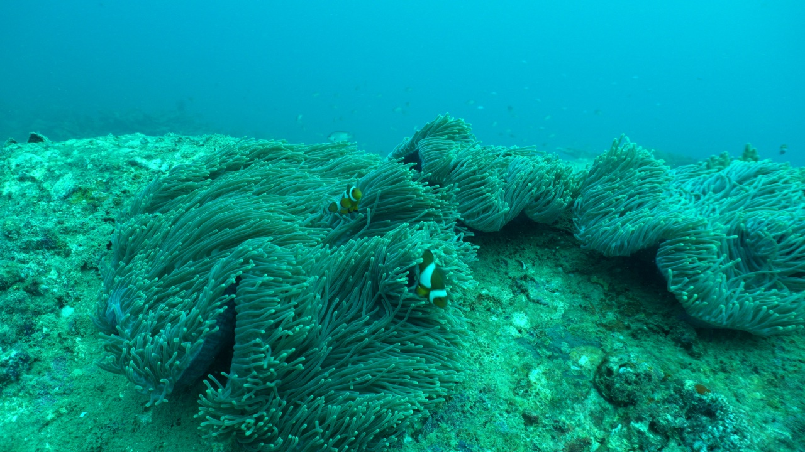
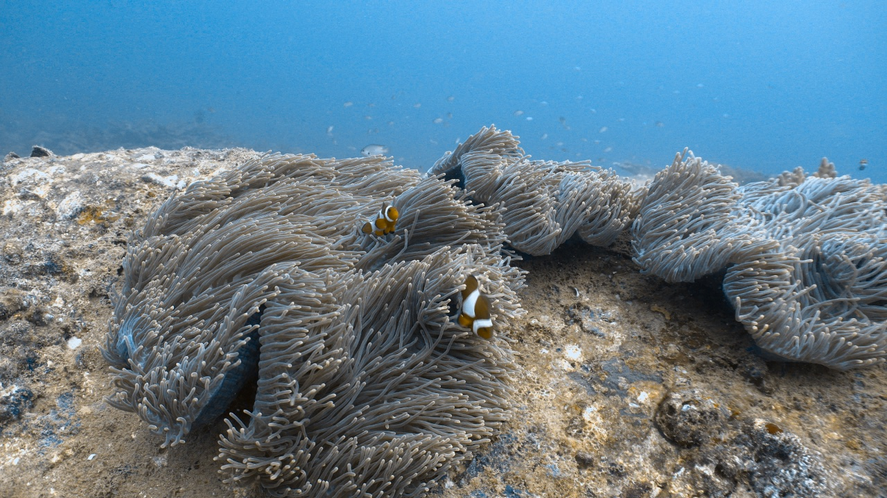

# UWMedia

UWMedia gives underwater photos and videos their colour back and puts the
dive computer's numbers on them: depth, temperature, dive time or a whole
dive-computer face, taken from the dive log for the moment each frame was
shot. One app for Windows, macOS, Linux, iPhone and Android.

| As shot | Colour corrected | With the dive and a watermark |
|---|---|---|
|  |  |  |


## What it does

- **Color**: colour correction worked out from the picture itself, every
  two seconds of a video, with a live preview. Originals are never changed.
- **Dive logs**: matched to photos and videos by time; reads FIT, UDDF and
  the exports of common dive computers and logbooks.
- **Overlays**: dive-computer faces and plain layouts, changed or built in
  the Overlay Designer, or written alone as a transparent video for a
  video editor.
- **Resize**, **Color Tuning**, **Tag Editor** (camera dates that are
  wrong) and the **Dive Profile Builder** (a dive log by hand).

On a computer the app does all of it, with FFmpeg and ExifTool included
in the download. On a phone it does Color, Resize, Color Tuning, the dive
logs and a simple tag editor, with the phone's own video engine.

## Status

The first release, v0.1.0, is in the works
([roadmap](docs/roadmap_v0.1.0.md)). Until then the Python desktop app,
[UWMedia](https://github.com/MickeMannen/UWMedia), is the one to download.

## License

MIT, see [LICENSE](LICENSE). The ffmpeg, ffprobe and exiftool shipped
with the desktop builds are separate programs under their own licences
(`assets/licenses/`, and About in the app).

## Code signing policy

Free code signing provided by [SignPath.io](https://signpath.io),
certificate by [SignPath Foundation](https://signpath.org).

- What is signed: the Windows builds of this project only, `uwmedia.exe`,
  the DLLs the same build compiles from source (the Flutter plugins'
  native parts) and the installer, built from this repository by the
  "Release Build" workflow on GitHub-hosted runners
  ([.signpath/](.signpath/README.md)). Files from third parties shipped
  with the app (the Flutter engine's `flutter_windows.dll`, ffmpeg,
  ffprobe, exiftool) are never signed with this certificate.
- Committers and reviewers: [Mikael Christersson](https://github.com/MickeMannen)
- Approvers: [Mikael Christersson](https://github.com/MickeMannen); every
  signing request is approved by hand.
- Privacy policy: this program will not transfer any information to other
  networked systems unless specifically requested by the user or the
  person installing or operating it. (The one request it makes, the
  update check on the About page, is sent only when that button is
  pressed.)

## Development

```bash
flutter pub get
git config core.hooksPath .githooks   # pre-commit runs the default suite
tool/run_tests.sh 1                   # format check, analyzer, tests
```

[CONTRIBUTING.md](CONTRIBUTING.md) covers setup, the test levels and the
test-data rules; [docs/](docs/README.md) holds the spec, the roadmaps and
the design notes.
