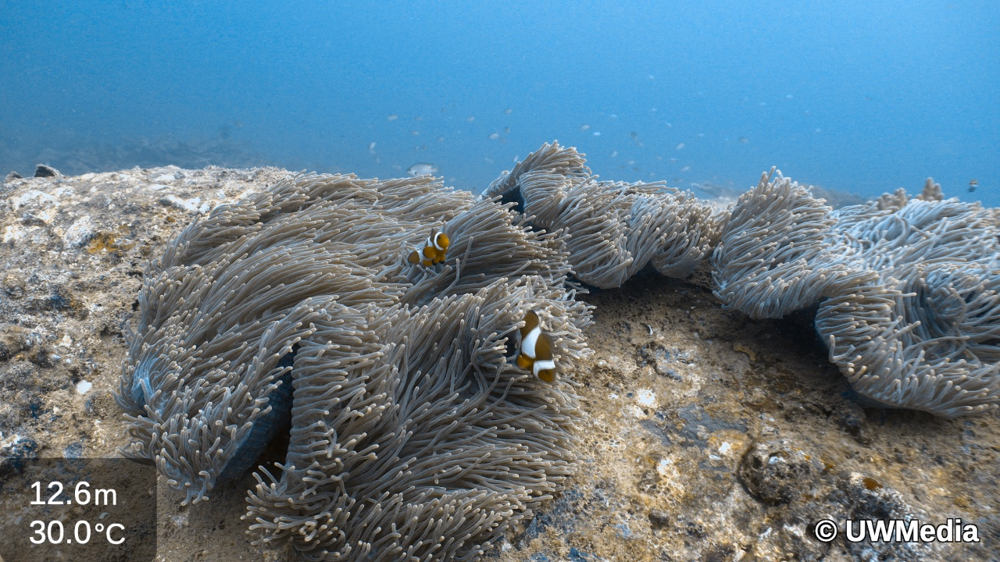
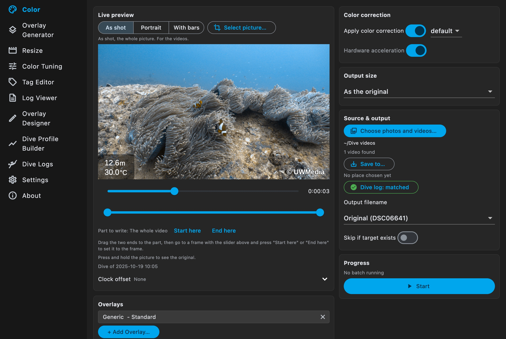

# UWMedia

UWMedia gives underwater photos and videos their colour back and puts the
dive computer's numbers on them: depth, temperature, dive time or a whole
dive-computer face, taken from the dive log for the moment each frame was
shot. One app for Windows, macOS, Linux, iPhone and Android.

| As shot | Colour corrected | With the dive and a watermark |
|---|---|---|
|  |  |  |



## What it does

- **Color**: colour correction worked out from the picture itself, every
  two seconds of a video, with a live preview. Originals are never changed.
- **Dive logs**: matched to photos and videos by time; reads FIT, UDDF and
  the exports of common dive computers and logbooks.
- **Overlays**: dive-computer faces and plain layouts, changed or built in
  the Overlay Designer, or written alone as a transparent video for a
  video editor.
- **Resize**, **Color Tuning**, **Tag Editor** (camera dates that are
  wrong) and the **Dive Profile Builder** (a dive log by hand).

## Dive-computer overlays

The overlays draw the screen of these dive computers, with the dive log's
numbers in it, each in the screen layouts listed:

| Dive computer | Screens |
|---|---|
| Garmin Descent Mk3i | main, standard, CCR, gases, transceiver, gauge |
| Garmin Descent X50i | main, gases, CCR, dynamic depth, gauge |
| Shearwater Perdix 2 | main, tec, CC, info screens, gauge |
| Shearwater Perdix 3 | main, air integration, standard, tec, CC, info screens, gauge |
| Shearwater Peregrine TX | main, air integration, mini displays, info screens, gauge |
| Shearwater Petrel | main, tec, CC (setpoint and 3 cells), info screens, gauge |
| Shearwater Teric | main, standard, CC, info screens, gauge |
| Shearwater Tern | main, standard, info screens, gauge |
| Suunto EON Core | classic, prominent, tank, graphical, CCR, gauge |
| Suunto EON Steel Black | classic, prominent, tank, graphical, CCR, gauge |
| Suunto Nautic | main, NDL / TTS with ppO2 / MOD |
| TUSA TC1 (IQ1301) | normal, simple |
| TUSA DC Solar Link (IQ1204) | basic display |

Beside them come plain overlays that fit any computer: depth and
temperature as a row, a column or a box (dark or light, and in two rows
for portrait video), and the dive profile with a dot where you are, also
with deco. The Overlay Designer changes any of them or makes a new one.

## Computer and phone

On a computer the app does all of it, with FFmpeg and ExifTool included
in the download. On a phone it does Color, Resize, Color Tuning, the dive
logs and a simple tag editor, with the phone's own video engine.

## License

MIT, see [LICENSE](LICENSE). The ffmpeg, ffprobe and exiftool shipped
with the desktop builds are separate programs under their own licences
(`assets/licenses/`, and About in the app).

## Code signing policy

- macOS: the download is signed with the author's Apple Developer ID
  (Mikael Christersson) and notarised by Apple, built from this
  repository by the "Release Build" workflow on GitHub-hosted runners.
- Windows and Linux: the downloads are not signed yet. Windows shows
  "unknown publisher" when the installer is started; "More info" and
  "Run anyway" start it. Compare the file with the one on the
  [releases page](https://github.com/MickeMannen/uwmedia-app/releases)
  if it came from anywhere else.
- Files from third parties shipped with the app (the Flutter engine,
  ffmpeg, ffprobe, exiftool) are theirs; on macOS they are signed as
  part of the app, as notarising requires.
- Committers, reviewers and approvers:
  [Mikael Christersson](https://github.com/MickeMannen); every release is
  started by hand.
- [Privacy policy](PRIVACY.md): this program will not transfer any
  information to other networked systems unless specifically requested by
  the user or the person installing or operating it. (The one request it
  makes, the update check on the About page, is sent only when that
  button is pressed.)

## Development

```bash
flutter pub get
git config core.hooksPath .githooks   # pre-commit runs the default suite
tool/run_tests.sh 1                   # format check, analyzer, tests
```

[CONTRIBUTING.md](CONTRIBUTING.md) covers setup, the test levels and the
test-data rules; [docs/](docs/README.md) holds the spec, the roadmaps and
the design notes.
